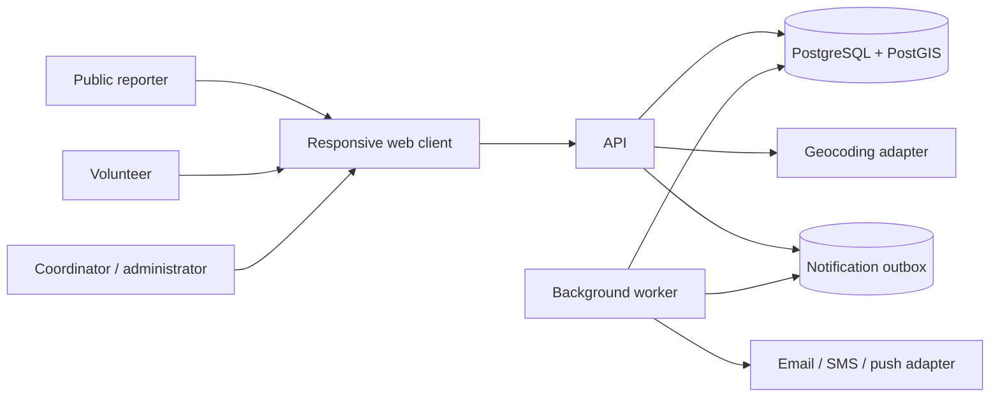
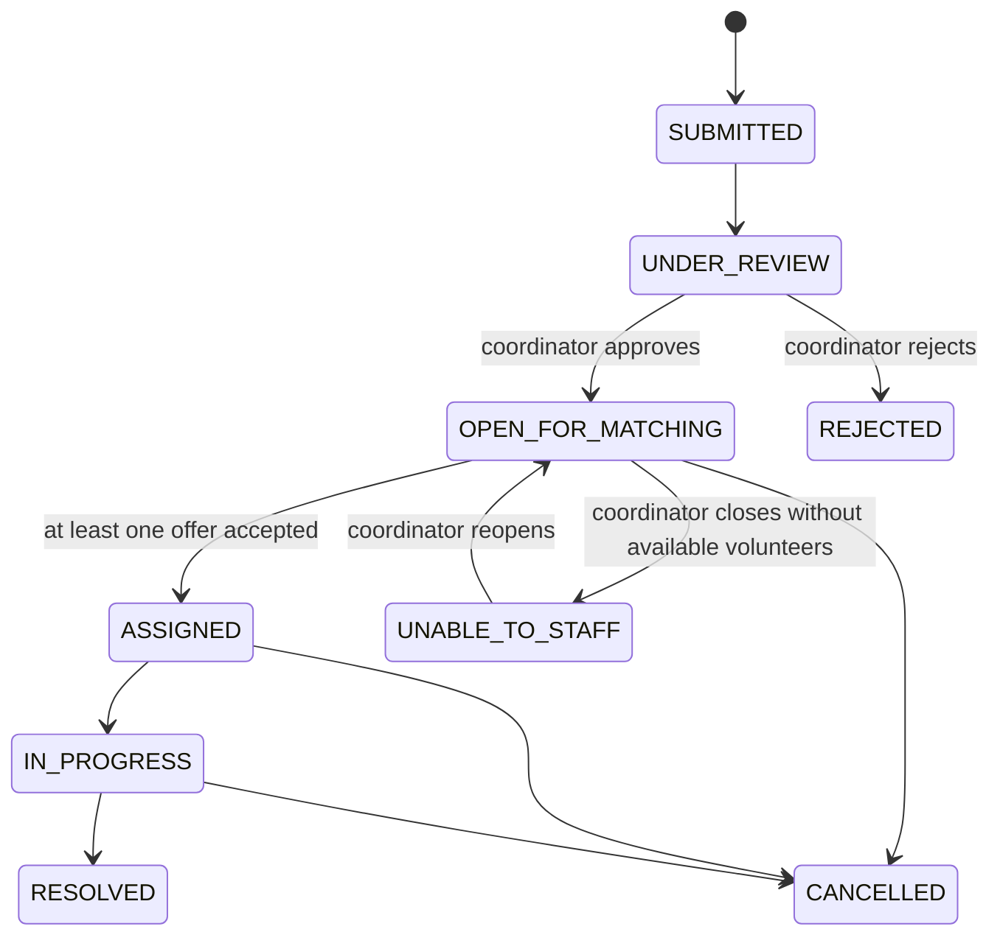

# QuickConnect Software Design

| Field   | Value                             |
| ------- | --------------------------------- |
| Status  | Draft for implementation planning |
| Version | 0.6                               |
| Date    | 6 November 2026                   |
| Source  | [SRS](SRS.md), version 0.6         |
| Target  | V1: one organization              |

## 1. Purpose and design summary

This document turns the QuickConnect SRS into a proposed design that engineers can use to begin implementation. The first release serves **one predefined organization**. Volunteers register into that organization's volunteer pool; coordinators, incident reporters, and administrators use the same organization context. There is no organization directory, organization selection, tenant provisioning, or cross-organization sharing in V1.

The proposed system is a browser application backed by a modular REST API and one relational database with geospatial support. Incident approval is always a coordinator action. Approval creates a stored candidate recommendation snapshot; the coordinator selects volunteers and explicitly sends offers. An accepted offer becomes an assignment only if the incident is still open and the volunteer remains eligible.

### 1.1 V1 design decisions

| Topic              | V1 decision                                                                                                                                                                                      |
| ------------------ | ------------------------------------------------------------------------------------------------------------------------------------------------------------------------------------------------ |
| Organization       | One organization configured at deployment. Users do not create or choose an organization.                                                                                                        |
| Incident intake    | Public form creates an unverified submission. It cannot start matching.                                                                                                                          |
| Incident approval  | Authenticated coordinator reviews, edits, prioritizes, and approves or rejects.                                                                                                                  |
| Matching           | Deterministic filter-and-rank operation, performed by the backend and stored with policy version and reason data.                                                                                |
| Assignment         | Coordinator approves a shortlist and sends offers. Volunteer acceptance confirms assignment transactionally.                                                                                     |
| Location           | When a volunteer switches on duty and grants browser location permission, the active browser page sends updates at the cadence for the volunteer's state. Switching off duty stops collection and uploads. |
| Client             | Responsive web application for volunteers, public intake, coordinators, and administrators.                                                                                                        |
| Backend            | Modular monolith with versioned REST API.                                                                                                                                                        |
| Persistence        | PostgreSQL with PostGIS.                                                                                                                                                                         |
| Async work         | Database-backed notification outbox and a worker process; no separate message broker initially.                                                                                                  |
| External providers | Geocoding and notification integrations behind adapters, selected/configured for deployment.                                                                                                     |

The application stack and server-side cookie-session authentication are agreed V1 decisions. The deployment region, map/geocoding provider, notification channels, and operational targets remain launch decisions; provider adapters and configuration points are included below.

## 2. Scope and actors

### 2.1 Actors

- **Public reporter:** Submits an incident without an account and receives a reference code. Cannot see other incidents or volunteer data.
- **Volunteer:** Registers an account into the configured organization, maintains profile and availability, receives offers, responds, and updates assignment status.
- **Coordinator:** Reviews public submissions, sets priority and requirements, approves incidents, reviews recommendations, sends offers, and manages incident progress.
- **System administrator:** Provisions coordinator/admin access and manages technical settings. V1 does not include self-service organization management.

### 2.2 Out of scope

Multi-organization tenancy, automatic dispatch, medical triage, direct integrations with emergency services, offline operation, native mobile apps, and a general-purpose messaging platform are outside V1.

## 3. System context and architecture



The browser client relies on the API for all authorization and business rules. It starts location updates when a volunteer switches on duty and stops them when the volunteer switches off duty. Browser location updates are available only while the page is active; background suspension or closure can interrupt them. The server independently enforces availability and location freshness before matching. The API owns incident state transitions, candidate eligibility, ranking, offer lifecycle, and assignment capacity checks. The worker delivers queued notifications and records outcomes. A provider failure must not roll back an incident or hide a failed delivery from coordinators.

### 3.1 Implementation stack

- **Web client:** React + TypeScript for volunteer, public intake, and coordinator/admin experiences. Volunteer location uses browser geolocation only while the volunteer is on duty and the page is active; the UI warns that browser suspension can interrupt updates.
- **Backend:** Python 3 + FastAPI, Pydantic request/response models, SQLAlchemy 2.x, Alembic migrations.
- **Database:** PostgreSQL + PostGIS for geospatial filtering and distance calculations.
- **Authentication:** Server-side sessions stored by the backend and identified by an opaque, secure cookie. Do not store bearer tokens or session state in browser local storage.
- **Worker:** Separate process using the same backend code and database-backed outbox; scheduled expiration task runs in the worker.
- **API style:** JSON over HTTPS under `/api/v1`.
- **Deployment:** Containerize the frontend, backend API, worker, and PostgreSQL/PostGIS database as separate services. Use Docker Compose for local development and an equivalent container orchestrator for deployment. Serve web and API on the same site (or same-site subdomains with explicit CORS/CSRF configuration) so cookie sessions remain same-site. Exact hosting is deployment-specific.

This is the selected V1 stack: React + TypeScript, FastAPI, and PostgreSQL. PostGIS supports radius queries and distance ranking.

### 3.1.1 Container layout

Each independently run part has its own container image and service. The API, worker, and one-shot migration job use the same backend image with different commands.

| Container/service | Image contents | Responsibility | Persistence |
|---|---|---|---|
| `frontend` | Production React build served by a small static web server | Serve the responsive web application and proxy or route same-site API requests to `backend` | None; static assets are part of the image |
| `backend` | FastAPI application and Python dependencies | Serve `/api/v1`, authentication/session endpoints, and application workflows | None; persistent data belongs in PostgreSQL |
| `worker` | Same backend image, worker entry point | Process notification outbox and expire offers | None; job state belongs in PostgreSQL |
| `migrate` | Same backend image, Alembic command | Apply database migrations once after the database is healthy and before the API/worker start | None; migration state is stored in PostgreSQL |
| `db` | PostgreSQL image with PostGIS extension installed | Store application records, sessions, audit events, and geospatial data | Named persistent volume for database files; backups stored separately |

For local development, a `compose.yaml` shall define the frontend, backend, worker, one-shot migration, and database services, a private application network, environment-based configuration, database health checks, startup dependency on database readiness, and a named volume for PostgreSQL data. The API and worker connect to the database by the Compose service name, not a hard-coded host address. Secrets shall be supplied through local environment files excluded from version control or the deployment secret store.

Local port mapping uses conventional defaults: frontend HTTP is published on host port `80`, FastAPI is published on `127.0.0.1:8000`, and PostgreSQL listens on port `5432` inside the Compose network without a host port mapping. The worker and migration job do not publish ports.

The database container must not use ephemeral storage. Recreating or upgrading the `db` container must preserve its named data volume, and database backups must be tested independently of that volume. Production can use the same database container image and volume-backed storage under an orchestrator; if the deployment platform requires a managed PostgreSQL service, it may replace the `db` container only with an explicit deployment decision and equivalent PostGIS, persistence, backup, and restore guarantees.

Container health checks should verify service readiness. The frontend waits for the backend route to be available, and the backend/worker wait for database readiness. Container restarts must not be treated as a substitute for database backup or application-level retry handling.

### 3.2 Backend modules

1. **Identity and Access:** Authentication, role checks, account state, password/session policy.
2. **Volunteer Profiles:** Registration, skill claims, verification metadata, availability, location consent and freshness.
3. **Public Intake:** Rate-limited submission, validation, reference code, duplicate/spam controls.
4. **Incident Management:** Review queue, incident fields, priority and status transitions.
5. **Matching:** Eligibility filtering, deterministic ranking, recommendation snapshots, explanations.
6. **Offers and Assignments:** Coordinator selection, offer issuance, response/expiry, concurrency-safe acceptance, status updates.
7. **Notifications:** Outbox creation, delivery adapters, retry policy, delivery status.
8. **Audit:** Append-only business audit events with actor and before/after context where appropriate.

Modules are code boundaries within one deployable API. They may share a database transaction and should not be split into microservices for V1.

## 4. Use Cases:

### 4.1 Volunteer onboarding

1. Volunteer creates an account and verifies the configured contact method.
2. The service associates the account with the sole organization implicitly.
3. Volunteer enters profile and skills. Skills remain unverified until an authorized coordinator records verification.
4. When the volunteer switches on duty, the browser explains location use, requests permission, and begins location updates after permission is granted. If permission is denied, duty remains off and the client explains how to resolve it.
5. Switching off duty stops geolocation watching immediately, sends the state change, and prevents later location uploads. The server marks the volunteer unavailable before acknowledging the change and excludes them from new match runs.
6. The page displays a tracking indicator, current permission state, and last successful location update time. If the page is suspended, updates may pause; stale location excludes the volunteer from matching. The volunteer can view and update profile, current offers, and assignments.

### 4.2 Public incident review and approval

1. Public reporter submits incident description, location, required assistance, and reply contact. Server validates and geocodes the location, applies abuse controls, and creates `SUBMITTED` incident.
2. The API returns a random public reference code. Public callers cannot read incident details later through a public lookup endpoint in V1.
3. Coordinator opens the review queue, examines and edits the report, assigns priority and required skills/credentials, then approves or rejects it.
4. Approval requires a valid point, priority, incident description, and coordinator identity. Approval transitions to `OPEN_FOR_MATCHING` and starts a matching run.
5. Matching stores all eligible candidates and their ranking explanation in a snapshot. The coordinator reviews candidates and selects one or more volunteers.
6. Coordinator sends offers. Selected volunteers receive a minimal-detail notification and sign in to view full authorized details.

### 4.3 Matching and offer lifecycle

1. Matching takes a consistent read of the incident requirements and currently eligible volunteer profiles.
2. It saves policy version, evaluated-at timestamp, configuration values, candidates, rank keys, and exclusion reasons.
3. Coordinator selection is validated against the current incident and profile state before offers are created.
4. Each offer has an expiry timestamp and is inserted with a notification outbox record in one database transaction.
5. On accept, the API locks the relevant incident/volunteer capacity rows, rechecks incident state and capacity, then changes the offer to accepted and creates the assignment atomically.
6. If capacity is no longer available or the incident has closed, acceptance returns a conflict and informs the volunteer and coordinator; it does not create an assignment.
7. On decline/expiry, the offer is recorded. Coordinator is notified and may rerun matching or select another candidate. No silent automatic expansion of the candidate list occurs in V1.

### 4.4 Incident and assignment state

Incident state machine:



`REJECTED` is added to make the SRS review/reject flow explicit. Rejection records reason and actor. Cancellation/resolution requires a coordinator; a volunteer may report `UNABLE_TO_HELP` or `COMPLETED`, which creates an assignment event and may prompt coordinator action rather than silently closing the whole incident.

Offer states: `PENDING`, `ACCEPTED`, `DECLINED`, `EXPIRED`, `WITHDRAWN`. Assignment states: `ASSIGNED`, `EN_ROUTE`, `ARRIVED`, `UNABLE_TO_HELP`, `COMPLETED`, `REMOVED`. Assignment is created only from accepted offer or a coordinator's documented manual assignment action.

## 5. Matching design

### 5.1 Location update policy

The browser client chooses its target update cadence from the volunteer's duty and assignment state. The browser may deliver updates later than requested or stop them when the page is suspended, the device is locked, or the browser closes. The server uses the location's capture time and receipt time, never assumes the requested cadence was met, and excludes stale locations from matching.

| Volunteer state | Target update cadence | Behavior |
|---|---:|---|
| Off duty | None | Stop geolocation watch and do not upload location. |
| On duty, stationary | Every 2–5 minutes | Use the lower-frequency cadence while movement remains below the configured movement threshold. |
| On duty, moving | Every 30 seconds | Increase update cadence when location samples indicate movement. |
| On duty, rapid movement | Every 10–15 seconds | Use higher cadence when measured movement exceeds the configured rapid-movement threshold. |
| Assignment accepted / En Route | Every 10–15 seconds | Use assignment tracking cadence while an active assignment is En Route. |
| Assignment completed | Stop assignment tracking | End assignment-specific high-frequency tracking. If volunteer remains on duty, return to the applicable on-duty cadence; if off duty, stop all tracking. |

Movement thresholds are calculated from consecutive valid browser location samples (distance divided by elapsed time) and are configuration values to finalize during implementation. Target cadence is best-effort: web browsers do not guarantee timer or location callbacks at exact intervals, particularly when the page is backgrounded. Location freshness limits must account for the selected cadence; the coordinator view shows sample capture time and freshness. An accepted or En Route assignment takes precedence over motion classification and uses the 10–15 second target. After assignment completion, tracking returns to the ordinary on-duty cadence if the volunteer remains on duty.

### 5.2 Configuration

Store one active `matching_policy` configuration record with a version. V1 settings:

- maximum matching radius in meters;
- maximum concurrent active assignments per volunteer;
- maximum volunteer-location age;
- offer response duration;
- required skill IDs and minimum proficiency/verification rules per incident;
- the fixed ranking rule version.

Configuration changes are audited and affect new matching runs only. Each match run stores a copy of the applied values so earlier results remain explainable.

### 5.2 Eligibility filter

For an approved incident, a volunteer is eligible only if all conditions hold:

1. Account is active and volunteer has not opted out.
2. Volunteer is on duty for the incident time window.
3. Volunteer has a location update within configured freshness for their current duty/assignment state. Saved service-area or home locations are never used as a substitute for live location in V1.
4. Distance from volunteer point to incident point is within configured radius.
5. Volunteer has every mandatory skill at the required proficiency; required credentials must be verified and unexpired.
6. Active assignment count is below configured maximum.

Save exclusion codes such as `INACTIVE_ACCOUNT`, `UNAVAILABLE`, `LOCATION_MISSING`, `LOCATION_STALE`, `OUTSIDE_RADIUS`, `MISSING_SKILL`, `CREDENTIAL_UNVERIFIED`, and `CAPACITY_REACHED`. Never store a freeform explanation in place of these structured reason codes.

### 5.3 Ranking

Use a deterministic ascending/descending tuple, in this order:

1. Skill score descending: required-skill proficiency aggregate, then count of verified required skills (mandatory skills still must pass eligibility), then count of additional relevant verified skills.
2. Geodesic distance ascending in meters, calculated by PostGIS geography distance.
3. Active assignment count ascending.
4. Seconds since last completed assignment descending; volunteers with no prior assignment sort first.
5. Volunteer UUID ascending as stable final tie-break.

The full tuple is stored with each candidate snapshot. Incident processing priority is separate: coordinator work queues sort Critical, High, Medium, Low, then oldest approved time. Priority does not affect volunteer ordering inside one incident.

**Skill scoring detail for implementation:** skill IDs and proficiency levels must be controlled values. Suggested proficiency scale: 1–5. For required skills, calculate the sum of volunteer proficiency for each required skill. Then compare count of verified optional relevant skills. This simple scoring formula is deterministic and can be changed only by incrementing policy version. The product owner should confirm this scoring before production; the schema supports the values now.

### 5.4 Match snapshot and reruns

Each run has an immutable `match_run` row and immutable candidate rows. A rerun creates a new run linked by incident; it does not overwrite history. The coordinator console uses only the latest run by default. Sending offers references both the run and selected candidate rows. A stale run may be submitted, but the send-offers command revalidates each selected volunteer and returns per-volunteer conflicts that the coordinator must resolve.

## 6. Data model

All tables use UUID primary keys, UTC timestamps, and database foreign keys. The application has one organization configured by environment/seed data; V1 records do not require `organization_id` because no organization switching or tenant filtering exists. The organization name, contact, and service area live in deployment configuration. If a second organization becomes a real requirement, introduce explicit tenant ownership and migrate before onboarding it; do not infer tenancy from email domains.

### 6.1 Main tables

| Table                        | Important fields and constraints                                                                                                                                                                                                                                                         |
| ---------------------------- | ---------------------------------------------------------------------------------------------------------------------------------------------------------------------------------------------------------------------------------------------------------------------------------------- |
| `users`                    | `id`, `email` unique case-insensitively, `password_hash`, `role` (`VOLUNTEER`, `COORDINATOR`, `ADMIN`), `status`, `email_verified_at`, timestamps. Public reporters are not user rows. |
| `server_sessions`          | `id`, user ID, hashed opaque session token, created/last-seen/expiry/revocation timestamps, user-agent summary. Cookie contains only the opaque random token; database stores its hash. |
| `volunteer_profiles`       | `user_id` PK/FK, display name, phone, `is_available`, `opted_out`, `location_permission_status`, active availability session ID, `last_location geography(Point,4326)`, `location_captured_at`, `location_received_at`, `location_accuracy_m`, `location_speed_mps`, `max_active_assignments` nullable override, profile status. |
| `availability_sessions`    | `id`, `volunteer_id`, started/ended timestamps, status, permission state last reported, last location timestamp, end reason. One active session per volunteer enforced by partial unique index.                                                                                      |
| `skills`                   | `id`, unique `code`, display name, active flag. Seeded/maintained by admin for this deployment.                                                                                                                                                                                      |
| `volunteer_skills`         | `volunteer_id`, `skill_id`, proficiency 1–5, verification status, verifier user, verified/expiry timestamps, unique volunteer+skill.                                                                                                                                                |
| `incidents`                | `id`, public reference unique, reporter name/contact, description, location text, `location geography(Point,4326)`, status, priority, source, required-by time, created/approved/rejected/closed timestamps, assigned coordinator, rejection/closure reason, optimistic `version`. |
| `incident_required_skills` | `incident_id`, `skill_id`, minimum proficiency, mandatory flag, verified credential required flag.                                                                                                                                                                                   |
| `match_runs`               | `id`, incident ID, run number, policy version, config JSON, incident version, started/completed timestamps, initiated by, result counts.                                                                                                                                               |
| `match_candidates`         | `match_run_id`, volunteer ID, eligible flag, rank nullable, exclusion codes JSON, ranking tuple JSON, distance meters, skill score, workload count; unique run+volunteer.                                                                                                              |
| `offers`                   | `id`, incident ID, volunteer ID, match run ID nullable for manual assignment, status, sent/expiry/responded timestamps, response note, created by; index pending by volunteer and incident.                                                                                            |
| `assignments`              | `id`, incident ID, volunteer ID, offer ID nullable, status, assigned/updated/completed timestamps, assigned by, removal reason; indexes for active count by volunteer and incident.                                                                                                    |
| `incident_events`          | `id`, incident ID, actor nullable, event type, from/to status, safe JSON details, timestamp. Append-only.                                                                                                                                                                              |
| `assignment_events`        | `id`, assignment ID, actor nullable, event type, from/to status, details, timestamp. Append-only.                                                                                                                                                                                      |
| `notification_outbox`      | `id`, recipient user/contact, channel, template key, minimal template data, status, attempt count, next attempt, provider ID/error summary, created/sent timestamps.                                                                                                                   |
| `audit_events`             | actor, action, entity type/id, request ID, timestamp, redacted before/after JSON, source IP where policy permits. Append-only.                                                                                                                                                           |

### 6.2 Indexes and database constraints

- GiST index on volunteer and incident geography.
- Partial unique index on `availability_sessions(volunteer_id)` where status is active; index active session and last location timestamp for freshness checks.
- Unique index on hashed session token; indexes on user ID and expiry for session lookup and cleanup.
- B-tree indexes on incident `(status, priority, approved_at)`, volunteer profile `(is_available, opted_out)`, offers `(volunteer_id, status, expires_at)`, assignments `(volunteer_id, status)`, and outbox `(status, next_attempt_at)`.
- Check constraints for status/priority enum values, proficiency range 1–5, nonnegative distance, and offer expiry after creation.
- Partial unique index allowing at most one active assignment for the same incident and volunteer.
- Geospatial and assignment-count calculations must happen server-side; client-supplied distance, skill score, or rank is ignored.
- Status changes go through domain service transactions and append event rows. Application DB role should not have permission to update/delete append-only event tables.

## 7. API design

All endpoints return JSON. Authenticated endpoints require a server-side session identified by a secure cookie. Error format:

```json
{
  "error": {
    "code": "OFFER_EXPIRED",
    "message": "This offer is no longer available.",
    "request_id": "uuid",
    "details": {}
  }
}
```

### 7.1 Public endpoints

| Method and path                   | Purpose                                                                                                                           |
| --------------------------------- | --------------------------------------------------------------------------------------------------------------------------------- |
| `POST /api/v1/public/incidents` | Submit a report. Rate limited; validates required contact, description and location; returns `202` and reference code.          |
| `GET /api/v1/public/config`     | Return safe public configuration such as supported assistance categories and emergency guidance. No private operational settings. |
| `POST /api/v1/auth/register`    | Register as a volunteer in the sole organization. Role is always `VOLUNTEER`; public clients cannot select role.                |
| `POST /api/v1/auth/login`       | Authenticate and issue a new opaque server-side session cookie.                                                                 |
| `POST /api/v1/auth/logout`      | Revoke the current server-side session and clear the cookie.                                                                      |
| `GET /api/v1/auth/csrf`        | Return a CSRF token associated with the current session for state-changing browser requests.                                      |

### 7.2 Volunteer endpoints

| Method and path                            | Purpose                                                                                                                                                                                                              |
| ------------------------------------------ | -------------------------------------------------------------------------------------------------------------------------------------------------------------------------------------------------------------------- |
| `GET /api/v1/me`                         | Current account and role.                                                                                                                                                                                            |
| `GET/PATCH /api/v1/me/profile`           | Read/update volunteer profile and skills.                                                                                                                                                                            |
| `PUT /api/v1/me/availability`            | Turn availability on/off. Turning on requires the client to have obtained required location permission; returns an availability session ID. Turning off revokes the session so future location updates are rejected. |
| `POST /api/v1/me/location`               | Submit a timestamped device location for the current availability session. Rejects if unavailable, session is revoked, timestamp is invalid, or accuracy is outside the configured limit.                            |
| `GET /api/v1/me/offers`                  | List current and recent offers.                                                                                                                                                                                      |
| `POST /api/v1/offers/{offer_id}/accept`  | Accept with transactional eligibility/capacity recheck.                                                                                                                                                              |
| `POST /api/v1/offers/{offer_id}/decline` | Decline with optional short reason.                                                                                                                                                                                  |
| `GET /api/v1/me/assignments`             | List active and recent assignments.                                                                                                                                                                                  |
| `POST /api/v1/assignments/{id}/status`   | Submit allowed assignment status transition.                                                                                                                                                                         |

### 7.3 Coordinator/admin endpoints

| Method and path                                                | Purpose                                                                                              |
| -------------------------------------------------------------- | ---------------------------------------------------------------------------------------------------- |
| `GET /api/v1/coordinator/incidents`                          | Paginated review/active queue with filters.                                                          |
| `GET /api/v1/coordinator/incidents/{id}`                     | Incident details, events, latest match run and assignment state.                                     |
| `PATCH /api/v1/coordinator/incidents/{id}`                   | Edit reviewed incident fields; requires `If-Match` incident version.                               |
| `POST /api/v1/coordinator/incidents/{id}/review`             | Transition Submitted to Under Review.                                                                |
| `POST /api/v1/coordinator/incidents/{id}/approve`            | Set priority/requirements and approve; creates match run.                                            |
| `POST /api/v1/coordinator/incidents/{id}/reject`             | Reject with required reason.                                                                         |
| `POST /api/v1/coordinator/incidents/{id}/match-runs`         | Recompute recommendations, recording actor and reason.                                               |
| `GET /api/v1/coordinator/incidents/{id}/match-runs/{run_id}` | Return eligible candidates and structured exclusions.                                                |
| `POST /api/v1/coordinator/incidents/{id}/offers`             | Submit selected volunteer IDs and match run ID; revalidate and create offers/outbox transactionally. |
| `POST /api/v1/coordinator/incidents/{id}/cancel`             | Cancel with reason and notify affected volunteers.                                                   |
| `GET /api/v1/coordinator/volunteers`                         | Search/filter volunteers with privacy-limited fields.                                                |
| `GET/PATCH /api/v1/coordinator/volunteers/{id}`              | View profile and record verification or administrative status.                                       |
| `GET/PATCH /api/v1/admin/settings/matching`                  | Read/change matching configuration; admin only and audited.                                          |
| `GET/POST /api/v1/admin/skills`                              | List/manage the single organization's skill taxonomy.                                                |

### 7.4 API behavior

- List endpoints use cursor pagination; maximum page size 100.
- Mutating operations accept an `Idempotency-Key` for retries and store the result for a bounded period.
- State-transition commands return `409 CONFLICT` for invalid or stale state, with current version/state in error details.
- Coordinator edits use optimistic concurrency via incident version/`If-Match` to prevent lost updates.
- Public intake and login/register endpoints require abuse controls: rate limits, validation, and CAPTCHA or equivalent when configured.
- API authorization is checked per endpoint and object; hiding a button in the client is not authorization.

## 8. Security and privacy design

- Enforce role authorization on the API. Public endpoints expose only safe configuration and submission response.
- Store passwords using a modern password hashing function and require verified email/contact before offers can be accepted.
- Use HTTPS and opaque server-side sessions identified by cookies marked Secure, HttpOnly, and SameSite. Rotate session IDs after authentication and privilege changes, expire inactive sessions, implement CSRF protection for state-changing cookie-authenticated requests, and use short-lived password-reset tokens.
- Do not store session identifiers or authentication tokens in local storage. Provide login, logout, session expiry, and account recovery endpoints.
- Keep secrets in deployment secret storage, not source control or client bundles.
- Restrict incident reporter contact and full incident descriptions to coordinators and volunteers with an active offer/assignment as operationally needed.
- Do not include incident descriptions, exact coordinates, or reporter contact in push/SMS/email. Notify with a generic request and authenticated deep link.
- Location is collected only while a volunteer has switched on duty and granted browser permission. Browser geolocation runs while the page is active; the browser may suspend it in the background or when closed. No client collects location while the volunteer is off duty.
- On availability-on, the client obtains permission, calls the availability endpoint, then starts geolocation updates using the returned availability session ID. On availability-off, the client stops geolocation immediately and sends the off command to revoke the server session. The API rejects updates for revoked sessions. If connectivity is lost, local tracking still stops immediately, the client retries the off command, and the server excludes the volunteer once the availability lease/location freshness expires; the UI shows pending server confirmation.
- Do not match using cached locations from a prior availability session. Starting a new session requires a fresh location update before the volunteer can become an eligible candidate.
- The browser client shall show a tracking indicator, current permission state, and last successful upload time. If the browser pauses or denies updates, the location becomes stale and the volunteer is excluded from new matches until updates resume.
- The browser client shall use the location cadence in Section 5.1 while the page is active and honor browser/device location accuracy controls.
- Redact contact data, credentials, exact location, and free-text incident content from routine logs. Audit privileged access without duplicating unnecessary sensitive values.
- Define retention and deletion jobs before launch; records under incident/audit retention may require anonymization rather than hard deletion.

## 9. Reliability and operational design

### 9.1 Transaction boundaries

- **Approve incident:** update state, append incident event, create match-run metadata; matching computation may run in the same request for V1. If computation is moved async, show `MATCHING_PENDING` as an operational substate and notify coordinator when ready.
- **Create offers:** validate incident and volunteers; insert offers and notification outbox rows in one transaction.
- **Accept offer:** lock volunteer/incident rows; validate pending offer, expiry, incident status, duplicate active assignment, and capacity; insert assignment, update offer, append events, enqueue confirmation notification in one transaction.
- **Outbox delivery:** worker claims rows with a lease/`SKIP LOCKED`, calls provider, records result, retries transient failures with exponential backoff and a maximum attempt count. Permanent failure remains visible in coordinator delivery status.

### 9.2 Failure handling

- Geocoder unavailable: retain submission with address text and mark location unresolved; it remains unmatchable until coordinator resolves the map point.
- Notification provider unavailable: preserve offers, retry outbox, show pending/failed delivery. Coordinator can use configured manual contact process.
- Database/API unavailable: clients show stale/offline state and do not claim actions succeeded; idempotency allows safe retry.
- Worker unavailable: outbox accumulates; alert on queue age/size and resume processing after recovery.
- No eligible candidates: store empty match run, set incident to `UNABLE_TO_STAFF` only when coordinator chooses that outcome; otherwise keep open and show no candidates.

### 9.3 Observability

Emit structured logs with request ID, actor ID where authenticated, endpoint, outcome, and latency. Metrics should cover API errors/latency, matching duration and eligible counts, pending/failed notification count and oldest age, expired offers, and incidents by state. Never log secrets or unrestricted incident payloads.

## 10. Frontend information architecture

### 10.1 UI color tokens

Use the following palette consistently across volunteer, public, and coordinator experiences:

| Color | Hex | Usage |
|---|---|---|
| Deep Navy | `#142B45` | Primary brand, sidebar, navigation |
| Teal | `#087E8B` | Primary actions, buttons, links |
| Emergency Red | `#DC4545` | Critical alerts and critical-priority incidents |
| Orange | `#E87532` | High-priority incidents |
| Amber | `#E5A32D` | Medium-priority incidents and warnings |
| Green | `#27966F` | Low-priority incidents and successful assignments |
| Light Blue Grey | `#EAF0F5` | Application background |
| White | `#FFFFFF` | Cards and content surfaces |

Priority and status must also be communicated with text labels and/or icons; color alone must not carry meaning. Use accessible text contrast on each token, especially Amber and Green, and test contrast for the chosen foreground/background pairings.

### Public

- Emergency guidance banner and incident report form.
- Volunteer registration/login.

### Volunteer web experience

- Profile and skills, verification labels, on-duty toggle, tracking indicator, permission status, and last location update time.
- Offer inbox with expiry, incident essentials, accept/decline actions.
- Active assignments with status update controls.

### 10.2 Mobile-first volunteer layout

Design volunteer routes from narrow phone viewports upward, then enhance the layout for tablets and desktops. The volunteer dashboard should show the on-duty control and current location freshness first, followed by pending offers and active assignments. Use a single-column flow on narrow screens, concise incident cards, and clearly separated accept/decline and assignment status actions. Keep the tracking state visible while the volunteer is on duty; show a clear stale-location state if browser updates pause. Forms should use short steps and mobile-appropriate input types, and the experience must not require horizontal scrolling. At wider breakpoints, the same information can use additional columns without changing the action order or hiding essential controls.

### Public and coordinator web app

- Emergency report form and guidance.
- Coordinator review queue, incident detail, matching/offer workflow, active incident board, volunteer directory, and administration.

### Coordinator

- Review queue sorted by submission time and priority when known.
- Incident detail and review form; approve/reject with required reason fields.
- Matching screen with ranked candidate table, score factors, distance/freshness, skills/verification, workload, exclusions, shortlist selection, and send-offer confirmation.
- Active incident board with offers, assignments, latest status, and delivery warnings.
- Volunteer directory and skill verification view.

### Administrator

- User role/status management, skill taxonomy, matching settings, and audit/event access.

## 11. Repository and implementation layout

Suggested structure (adapt to existing tooling once the scaffold is selected):

```text
compose.yaml
frontend/
  Dockerfile
  src/ (routes, components, api client, state, validation)
backend/
  Dockerfile
  app/
    api/v1/
    domain/ (incidents, volunteers, matching, offers, assignments)
    services/ (geocoding, notifications, audit)
    db/ (models, repositories, migrations)
    worker/
  tests/
docs/
  SRS.md
  Software-Design.md
```

Keep ranking and state-transition functions free of HTTP and database concerns where practical; this makes the policy straightforward to review and change.

## 12. Implementation sequence

1. **Foundation:** React + TypeScript web scaffold, FastAPI service, configuration/secrets, PostgreSQL/PostGIS, migrations, API error format, request IDs, deployment environments.
2. **Identity and roles:** volunteer registration, login/session, administrator-provisioned coordinator, API authorization.
3. **Volunteer profile and tracking:** profile, skill taxonomy, verification, on/off-duty state machine, browser permission flow, adaptive location cadence, location update API, stale-location display and matching exclusion.
4. **Incident intake/review:** public form and abuse controls, review queue, edit/approve/reject state transitions and audit events.
5. **Matching:** PostGIS queries, eligibility reasons, deterministic ranking, immutable match snapshots, coordinator matching UI.
6. **Offers and assignments:** transactional offer creation, notification outbox/worker, response expiry, acceptance race handling, assignment states.
7. **Operations and hardening:** retention, delivery failure handling, metrics, backups/restore, accessibility review, security review, load targets.

Each step should land as a working vertical slice with migrations and API/UI behavior. Do not enable real emergency operations until the unresolved launch decisions in Section 13 are settled and response procedures are staffed.

## 13. Decisions required before production

1. **Organization details:** deployment name, service area, administrator/coordinator provisioning, and support contact.
2. **Authentication:** email verification and account recovery requirements. Session storage and secure cookie authentication are selected.
3. **Location policy:** supported browser matrix, permission wording, movement thresholds, freshness limit, radius, distance display, retention, and behavior when browser suspension delays updates. V1 does not match against saved service-area locations.
4. **Skill policy:** accepted skill catalog, proficiency definitions, mandatory versus optional skills, credential evidence and expiration rules, and approval of proposed skill score.
5. **Priority policy:** who may set each level and operational response expectation per level.
6. **Notifications:** supported channels/provider, offer duration, retry schedule, and manual escalation process.
7. **Public intake:** required reporter contact details, anti-abuse/CAPTCHA approach, duplicate handling, and whether reporter can check status.
8. **Privacy and safety:** launch jurisdiction, retention periods, volunteer verification/safeguarding, incident access, and emergency guidance wording.
9. **Service targets:** hosting, expected users/incidents, uptime, latency, backup recovery point/time, and on-call ownership.

## 14. Requirements traceability

| SRS area                                                     | Design sections     |
| ------------------------------------------------------------ | ------------------- |
| Accounts, roles, volunteer profile (FR-001–006)             | 2, 4.1, 6, 7, 8, 10 |
| Public incident intake, review, approval (FR-010–018)       | 4.2, 4.4, 6, 7, 8   |
| Eligibility, deterministic matching, rationale (FR-020–027) | 5, 6, 7             |
| Notifications, offers, assignment capacity (FR-028–035)     | 4.3, 6, 7, 9        |
| Assignment status and closure (FR-036–039)                  | 4.4, 6, 7, 10       |
| Audit and administration (FR-040–043)                       | 6, 7, 8, 9, 10      |
| Security, privacy, reliability, auditability (NFR-001–010)  | 3, 8, 9             |

## 15. Revision history

| Version | Date            | Changes                                                   |
| ------- | --------------- | --------------------------------------------------------- |
| 0.1     | 6 November 2026 | Initial implementation design for single-organization V1. |
| 0.2     | 6 November 2026 | Set browser-only support, update cadence, cookie sessions, selected stack, and UI color tokens. |
| 0.3     | 6 November 2026 | Specified a mobile-first layout for volunteer browser workflows. |
| 0.4     | 6 November 2026 | Defined separate frontend, backend, worker, and PostgreSQL/PostGIS containers. |
| 0.5     | 6 November 2026 | Added the one-shot migration container and documented the Compose startup order. |
| 0.6     | 6 November 2026 | Set local frontend/API ports to 80 and 8000 and kept PostgreSQL internal on 5432. |
